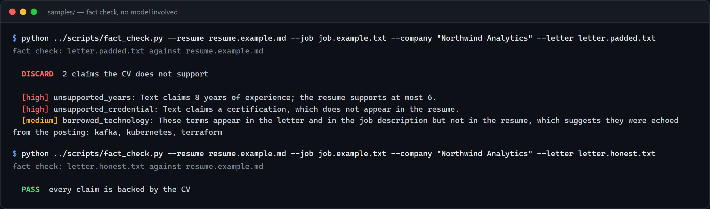
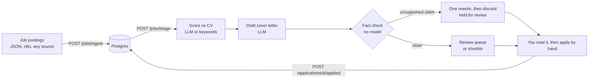
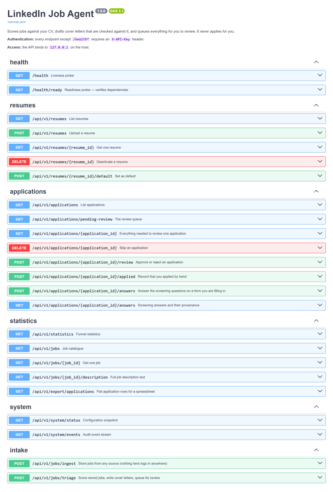

# LinkedIn Job Agent

Scores jobs against your CV, drafts a cover letter, and checks that letter for claims your CV can't back up. You do the applying.



## What it does

You give it job postings. For each one it:

1. **Scores the job against your CV**, from 0 to 100, with the reasoning, matched skills and missing skills.
2. **Drafts a cover letter** for the ones worth your time.
3. **Fact-checks the letter with plain code, no model involved.** If the letter claims 8 years when your CV shows 6, or a certification you don't have, the model gets one rewrite with the problems listed. If it still claims them, the letter is thrown away and the job waits for you. Tools copied from the job ad but missing from your CV are flagged for review.
4. **Queues it for you.** You read it, open the posting, and apply yourself. Then you tell the API you did, so that job never comes back.

It never logs in to LinkedIn, never opens a browser, and never submits anything.

### Why it doesn't press Apply

The first version did. It drove LinkedIn's Easy Apply through a real browser, logged in as me, with rate limits and a review step. LinkedIn still flagged the account, mostly because of the page loads I spent debugging selectors against the live site. I cut the browser half and kept the half that was actually useful: deciding which jobs are worth it, and writing something true about myself for each one. The post-mortem, with numbers, is in [docs/LESSONS.md](docs/LESSONS.md).

## How it works



| Step | What happens | Code |
|---|---|---|
| Ingest | Stores postings. Rejects anything without a real description, because scoring an empty posting gives a confident number based on nothing. | `services/triage.py` |
| Score | Asks the model for a score and reasons. If the model is down, falls back to keyword matching and marks the result for review. | `services/scoring.py` |
| Draft | Writes a letter from your CV and the posting only. | `services/cover_letter.py` |
| Fact check | Checks year claims, degrees and certifications, and tools that appear in both the letter and the job ad but not in your CV. | `services/fabrication_guard.py` |
| Review | Approve, edit the letter, or reject. A strong, clean match can go straight to your shortlist if you allow it. | `api/routes/applications.py` |
| Screening questions | Paste the questions from the real form. Each is answered from your profile file, or by a model limited to your profile and CV, or left blank with the reason. | `services/question_answering.py` |

## Features

- **Honest scoring.** A "not a match" verdict overrides a passing number, and a score computed without a model always goes to review.
- **A fact check you can run on its own.** `scripts/fact_check.py` checks any letter against your CV, including one you wrote or one a chatbot wrote.
- **Three things always wait for you**, whatever the config says: a letter that failed the fact check, a question it couldn't answer from known facts, and a score made without a model.
- **Any OpenAI-compatible model**, a local Ollama model, or no model at all (`AI_PROVIDER=rules`: keyword scoring only, and it refuses to write letters).
- **Notifications** on Telegram, Discord, Slack or email when jobs are waiting.
- **n8n workflows** for a daily digest, a weekly report, a Google Sheet mirror, and approving from your phone.
- **Logs redact secrets** in a structlog processor, so a careless log line can't leak a key.

## Tech stack

| | |
|---|---|
| API | Python 3.12, FastAPI, Pydantic |
| Data | PostgreSQL 16, SQLAlchemy (async), plain SQL migrations |
| AI | Any `/v1/chat/completions` endpoint, Ollama, or rules only |
| Automation | n8n (optional) |
| Quality | pytest, ruff, mypy (strict), GitHub Actions |
| Runtime | Docker Compose |

## Run it

```bash
git clone https://github.com/shakaibarsalan/linkedin-job-agent.git
cd linkedin-job-agent

cp .env.example .env                                  # set API_KEY, POSTGRES_PASSWORD, AI_API_KEY
cp config/answers.example.yaml config/answers.yaml    # your facts for screening questions

docker compose up -d --build                          # API docs at http://localhost:8088/docs
```

Then upload a CV, send it some jobs, and score them:

```bash
KEY=your-api-key
curl -H "X-API-Key: $KEY" -F label=main -F file=@samples/resume.example.md \
     http://localhost:8088/api/v1/resumes
curl -H "X-API-Key: $KEY" -H "Content-Type: application/json" \
     -d @samples/jobs.example.json http://localhost:8088/api/v1/jobs/ingest
curl -H "X-API-Key: $KEY" -X POST http://localhost:8088/api/v1/jobs/triage
curl -H "X-API-Key: $KEY" http://localhost:8088/api/v1/applications/pending-review
```

Try the fact check on its own, without Docker or an API key:

```bash
pip install -r backend/requirements.txt
python scripts/fact_check.py --resume samples/resume.example.md \
  --job samples/job.example.txt --company "Northwind Analytics" \
  --letter samples/letter.padded.txt
```

Add `--profile n8n` to `docker compose up` for a local n8n, then import the files in `n8n/workflows/`.



## Configuration

Everything lives in `.env`. The ones that matter:

| Variable | Default | What it does |
|---|---|---|
| `API_KEY` | none | Required. Sent as `X-API-Key` on every request. |
| `AI_PROVIDER` | `openai_compatible` | `openai_compatible`, `ollama`, or `rules` (no model). |
| `AI_BASE_URL`, `AI_MODEL`, `AI_API_KEY` | OpenAI | Any compatible endpoint: OpenAI, Gemini, Groq, OpenRouter. |
| `MIN_SCORE_TO_APPLY` | `70` | Below this a job is skipped. |
| `REVIEW_MODE` | `always` | `always`, `threshold` or `never`. Controls the shortlist, never submission. |
| `AUTO_APPLY_SCORE_THRESHOLD` | `85` | With `threshold`, clean matches at or above this skip the queue and go to your shortlist. |
| `NOTIFY_TELEGRAM_ENABLED` and friends | off | Where to tell you that jobs are waiting. |

The full list, with comments, is in [.env.example](.env.example).

## Safety and limits

- It doesn't log in anywhere, store a session, or submit an application. Applying is your click.
- LinkedIn's User Agreement forbids automated access. This repo doesn't touch LinkedIn. How you collect job postings is up to you, so use a source you're allowed to use.
- The fact check is a safety net, not proof. It catches inflated years, invented credentials and copied skills. It won't catch every vague overclaim, which is why review is the default.
- Job descriptions and your CV go to whichever model provider you configure. Use `ollama` or `rules` if that's not OK.
- The API binds to `127.0.0.1`. Keep it there, or put real auth in front of it.

## Tests

```bash
cd backend
pip install -r requirements-dev.txt
pytest                      # scoring policy, fact check, AI layer, profile answers, log redaction, settings
ruff check app tests && mypy app
```

## License

MIT. See [LICENSE](LICENSE).

## Author

Shakaib Arsalan · [shakaib.vercel.app](https://shakaib.vercel.app) · [LinkedIn](https://www.linkedin.com/in/shakaib-arsalan)
